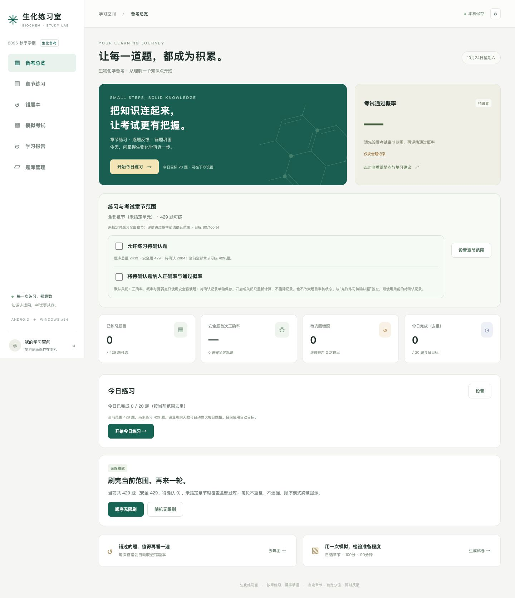
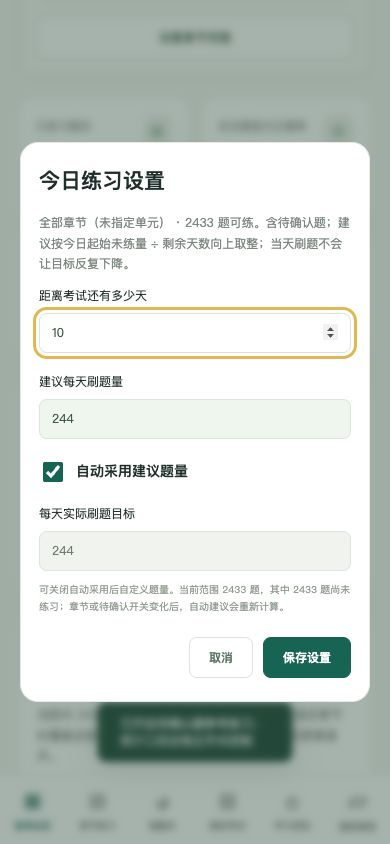

# 生化练习室 · Biochem Practice

面向生物化学课程复习与模拟考试的离线刷题应用，支持 **iPhone / iPad 主屏幕应用**、**macOS 12.3+（Apple 芯片与 Intel 通用）**、**Android 8.0+** 和 **Windows 10/11 x64（Intel/AMD）**。当前版本 **1.6.0**。

## 1.6.0 新增

- **iPhone / iPad 无需上架**：[Safari 打开应用](https://wasd0515.github.io/biochem-practice/dist/)，分享 → 添加到主屏幕，等待“离线已就绪”。无需付费开发者账号或定期重签名。建议 iOS / iPadOS 16.4+ 并更新 Safari。
- **macOS 通用应用**：轻量独立应用，内置全部题库，支持文件导入、原生备份保存、教师文件夹监测及对应 Mac 安装包更新检查。DMG 拖入 Applications 安装。
- **离线与更新**：网页资源完整缓存后切换版本；用户确认后才刷新，模拟考试中先交卷。不同应用的缓存互不清理。
- [苹果设备安装与使用指南](docs/苹果设备安装与使用.md)。

## 1.5.0 功能保留

- **待确认题统计开关**：首页范围卡片、概率详情、章节页、模拟设置与应用设置均可切换。开启时使用安全客观题首次作答 + 各题型待确认题首次自评，每题最多一个样本；安全主观题仍不参与拟合。范围外、被删题不计入。
- **旧记录兼容**：从历史中恢复最早可用待确认自评，重复刷题不增加独立样本。开关状态、备份和重启后记录均保留。
- **检查更新**：设置 → 软件更新 → 检查更新。支持启动时安静检查、查看更新说明、安卓APK或Windows x64对应下载，使用系统浏览器手动安装。离线/网络失败时仍可练习。
- 详情见[统计与更新检查说明](docs/统计与更新检查.md)。

## 下载与安装

从 [最新 Release](https://github.com/WASD0515/biochem-practice/releases/latest) 下载：

|设备|文件|安装方式|
|---|---|---|
|安卓手机/平板|`Biochem-Practice-1.6.0.apk`|传到设备并打开，按系统提示允许对应来源安装|
|Windows 64位电脑|`Biochem-Practice-Setup-1.6.0-x64.exe`|运行安装向导，可选择目录与桌面快捷方式|
|Mac 电脑|`Biochem-Practice-1.6.0-mac-universal.dmg`|打开后拖入 Applications；也提供 ZIP；尚无 Developer ID 签名及苹果公证|
|iPhone / iPad|[在线安装入口](https://wasd0515.github.io/biochem-practice/dist/)|Safari → 分享 → 添加到主屏幕，首次联网缓存完成后离线使用|
|开发者/教师|`Biochem-Practice-Source-1.6.0.zip`|完整公开源码、文档、模板和当前题库|

三个独立安装平台均内置题库，安装后可离线使用，无须注册账号。升级前建议在应用内导出学习备份；正式安卓安装包沿用同一签名。Windows 安装程序尚无商业代码签名，系统可能显示发布者未知。尚未在安卓及 Windows 真机完成安装运行验证，已完成核心逻辑、网页界面、安装包结构与安卓签名检查。

**苹果版本验证边界**：已在 Apple 芯片 Mac 实际启动应用并验证题库、持久保存和备份导出；Intel 架构已编译，未在 Intel 真机运行。iPhone 主屏幕版已完成移动端及离线自动检查，尚未在实体 iPhone 测试。网站记录可能被系统回收，请定期导出备份。

## 界面预览



|手机首页|每日计划设置|
|---|---|
|||

## 可以做什么

- **章节练习**：按教材36个固定章节组织，可新增章节；归属不明确的题目放入“其他章节”。章内支持筛选、编辑、单题删除与批量删除。
- **即时反馈与错题集**：客观题答后看答案，主观题参考要点自评；支持错题重练、收藏和连续巩固。
- **顺序/随机无限刷**：完整遍历当前可练范围；按所选章节和待确认题开关统一计算题量。
- **模拟考试**：常规模拟卷100分、考研练习150分预设；可自定章节、题型、题量、分值和时长。过程隐藏答案、支持随时交卷及到时交卷。
- **每日计划**：填写距离考试天数，按范围内未练题量生成建议，也可自设每日目标。
- **学习评估**：先设置考试章节范围，再查看考试通过概率和薄弱点。概率是未经真实考试成绩校准的条件估计，不是成绩承诺。
- **教师题库**：支持 JSON、规范 TXT、CSV 与 DOCX 导入；可从 GitHub 版本目录一键导入。Windows 与 macOS 可监测教师文件夹更新。
- **本地数据**：学习记录存放在本机，支持导出与恢复；本项目不会接收学生作答数据。

## 当前题库与数字口径

内置题库为风险修复第五版：**2433题 = 429道安全题 + 2004道待确认题**，其中114道归入“其他章节”。安全状态来自源文件标记与结构校验，不代表已逐题由教师审定。

默认只练安全题；开启“允许练习待确认题”可练全部2433题。待确认题参考作答与自评。新增独立开关“将待确认题纳入正确率与通过概率”，默认关闭；开启后首次自评与旧记录参与综合首次得分率、通过概率及薄弱点，界面明确标注“含待确认自评”。关闭后恢复仅安全客观题统计，记录保留。两个开关互不依赖，练习开关关闭时也可统计此前的待确认记录。选择章节后，可练数、每日计划、无限刷及组卷进一步限定在该范围；题库库存总量独立显示。无指定范围时覆盖全部；明确取消全部章节并保存时范围为零。

## 苹果设备预览


## 新增功能预览


## 教师从这里开始

1. [题库导入教程](docs/题库导入教程.md)：导入、更新、选章、GitHub分发与故障排查。
2. [题库格式规则](docs/题库格式规则.md)：字段、审核状态与八种题型。
3. [八题型 JSON 模板](templates/questions-8-types.json)、[TXT 模板](templates/questions-8-types.txt)、[固定章节名称](templates/chapters.txt)。
4. [AI 整理提示词](ai/AI整理提示词.txt)：将原始题目、答案和模板一起交给具备文件读取能力的 AI。
5. [AI 制库操作指南](ai/教师AI制库指南.md)：核对来源、保留疑点、避免把 AI 猜测当正式答案。
6. [开发与构建](docs/开发与构建.md)、[命令行同步与发布](docs/命令行同步与发布.md)、[验证记录](docs/验证记录-1.6.0.md)。

当前版本**没有内置在线 AI 识别和多教材切换**。AI 提示词用于在外部工具中辅助整理；目前一个题目对应一个主章节。教师审核后的题库再导入应用。

## 在线版本题库

本仓库 `data/index.json` 提供版本索引。在应用“题库管理 → GitHub题库版本”中填写：

|项目|值|
|---|---|
|GitHub 用户名|`WASD0515`|
|仓库|`biochem-practice`|
|分支|`main`|
|数据目录|`data`|

保存并读取版本，选择题库后点“一键导入”。当前 `biochem-v5` 与1.6.0内置题库一致，相同ID更新，不会额外复制2433题。网络不可用时可下载 [题库JSON](data/biochem-v5/questions.json) 后手动导入。

## 项目结构

```text
dist/               应用界面、引擎、内置题库与离线资源
native/android/     安卓WebView外壳（不含签名密钥）
native/windows/     Windows Electron外壳
native/macos/       macOS 原生 WebKit 外壳
tools/              测试、题库生成与安卓构建脚本
source-data/        当前题库原始JSON和核对报告
templates/          八题型模板与章节目录
ai/                 教师制库提示词和操作指南
data/               GitHub版本题库发布目录
docs/               教程、界面截图与验证记录
```

## 内容与授权

项目公开提供源码、模板和教学资料，目前尚未指定开源许可证。题目、教材章节及引用内容的权利归原作者或相应权利人；发布者维护题库来源与审核状态。第三方 fflate 的许可证位于 `dist/vendor/fflate-LICENSE.txt`。请勿向本仓库提交学生学习备份、个人信息、令牌或签名密钥。
